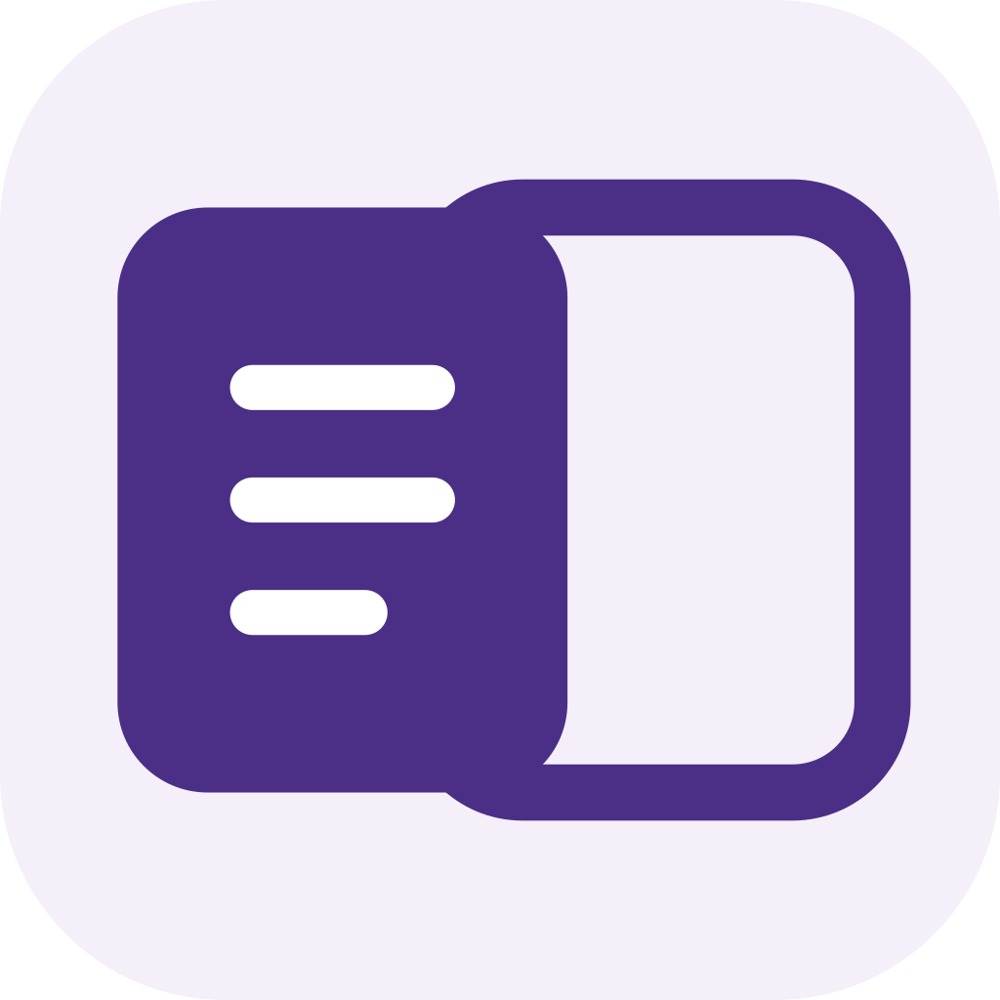
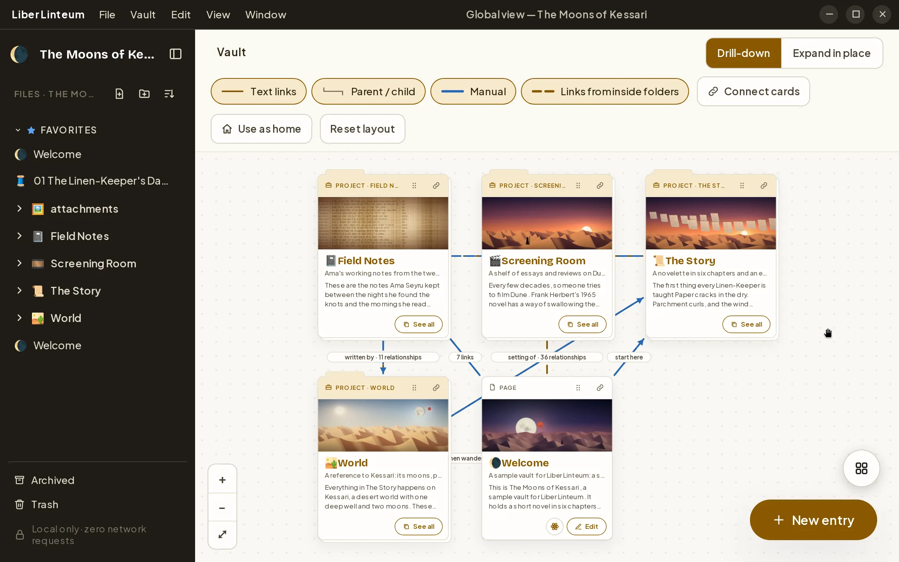
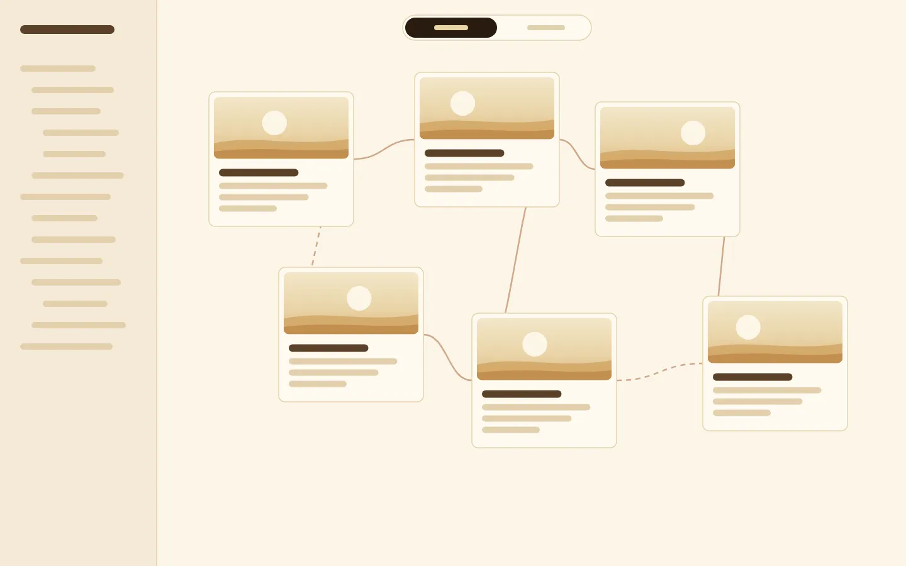
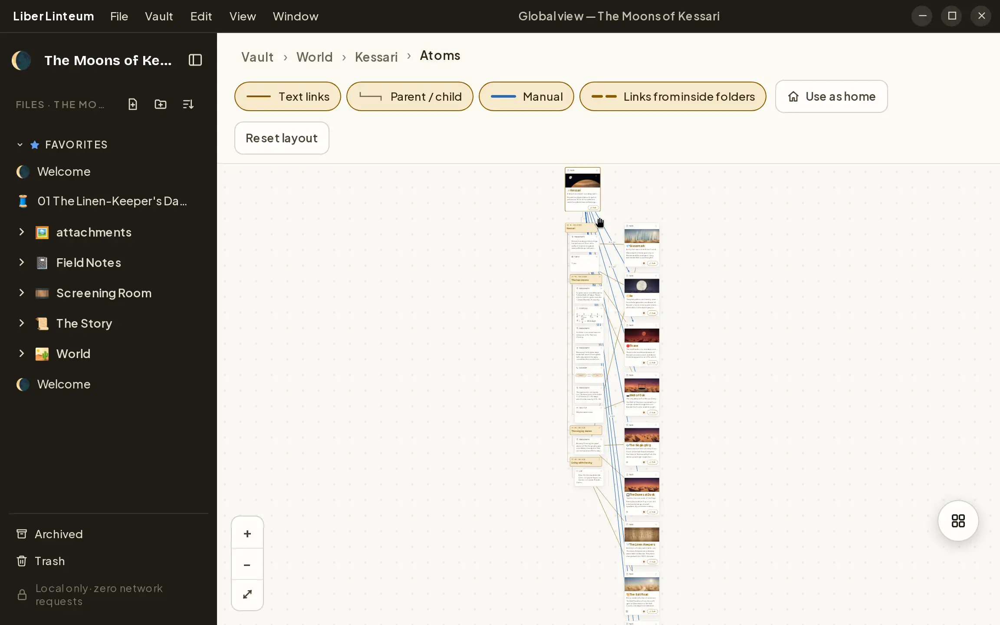
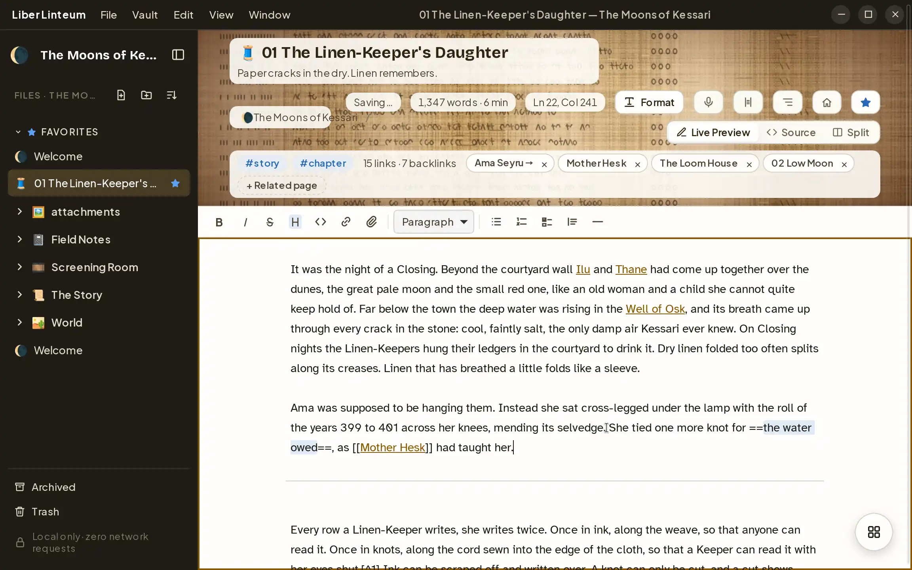
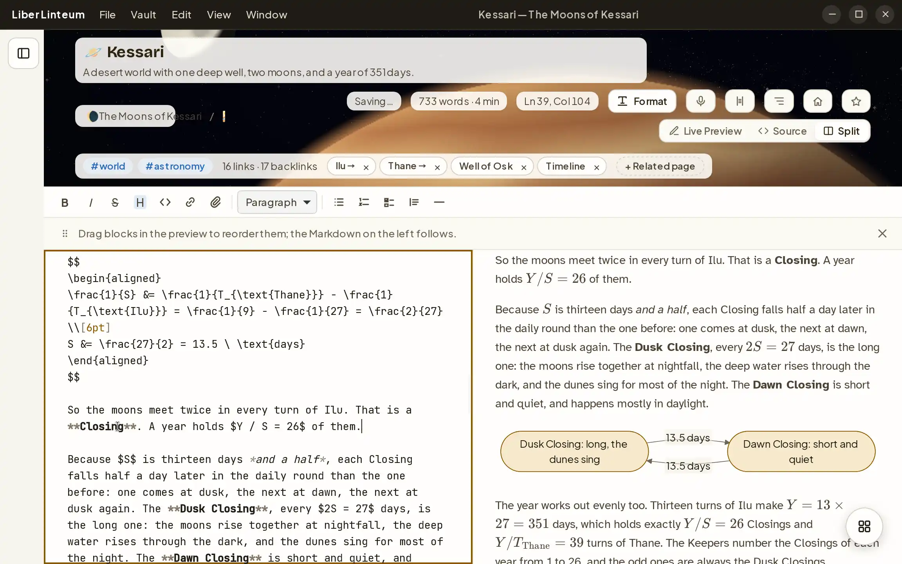
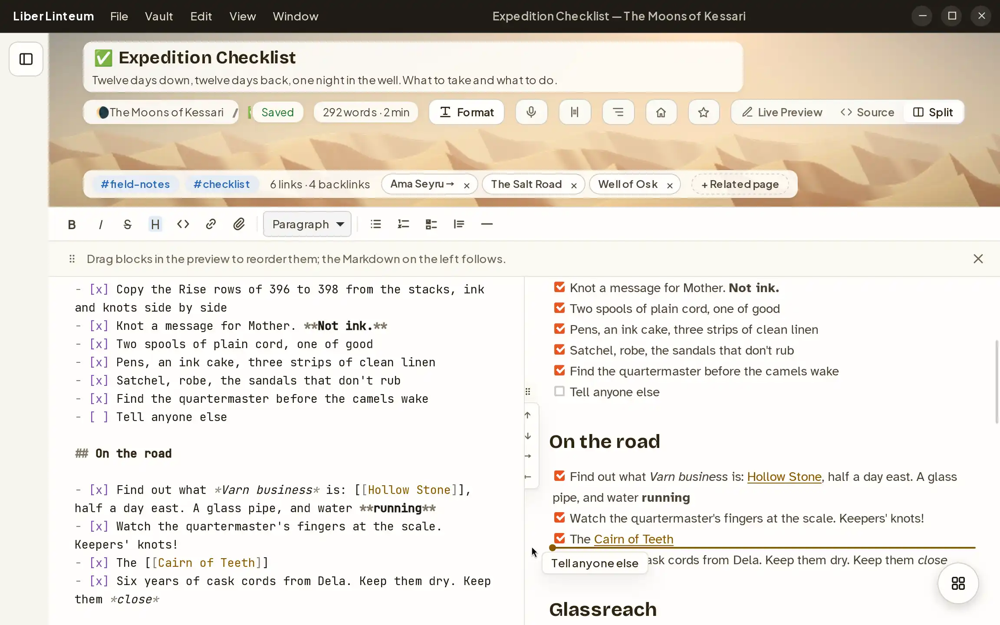
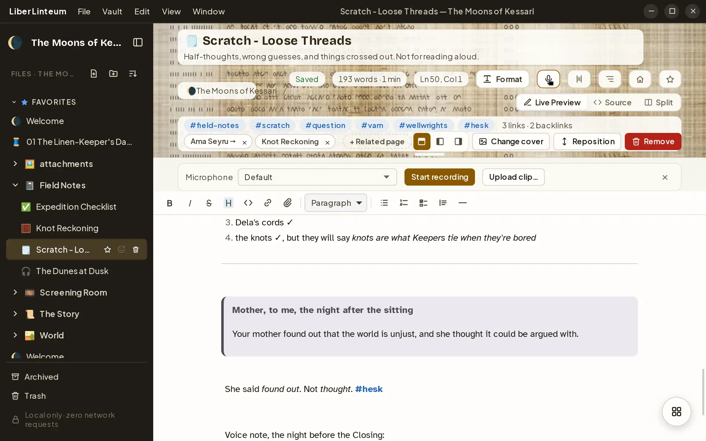
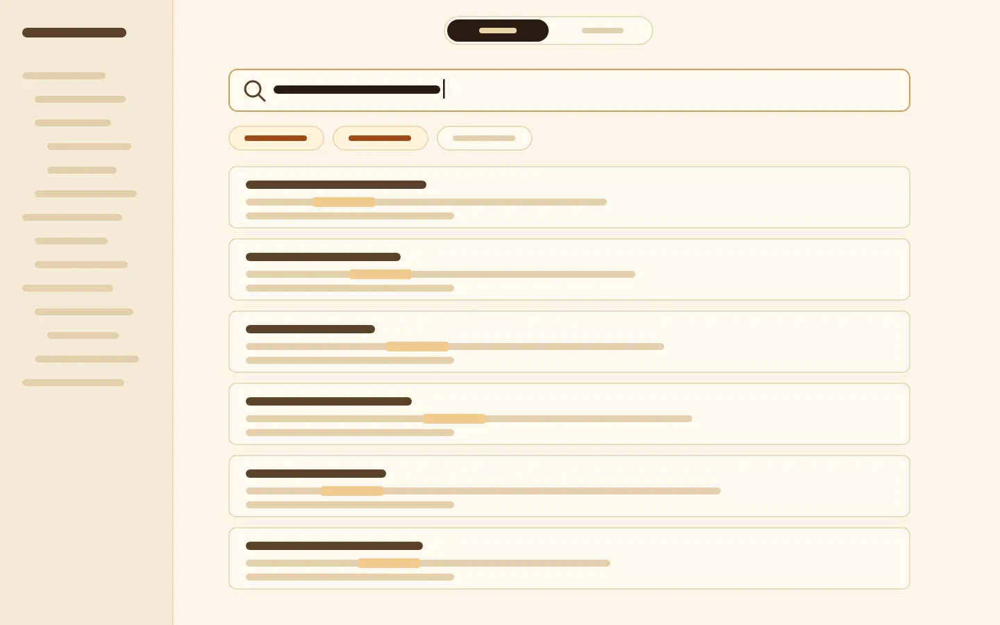
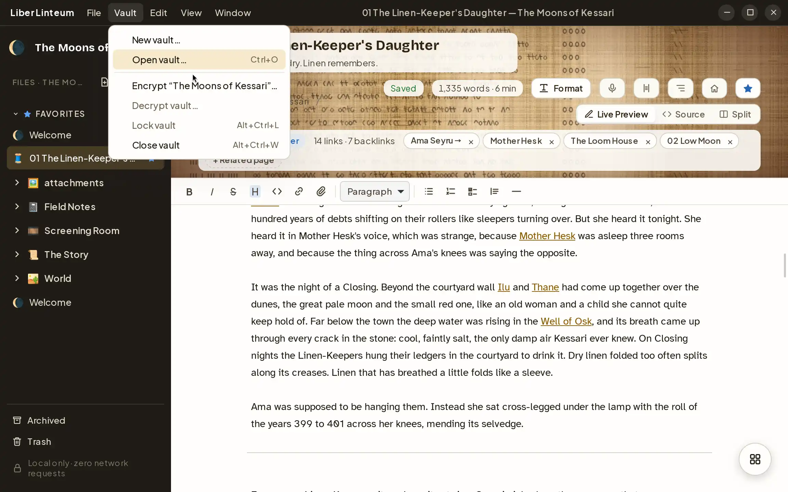

<div align="center">



# Liber Linteum

**Private notes that stay on your machine.**

Your notes are plain Markdown files in a folder you own. A canvas of cards shows how they
connect. Nothing leaves your computer: no cloud, no accounts, no telemetry.

[Website](https://jorius.github.io/liber-linteum/) ·
[Download](https://github.com/jorius/liber-linteum/releases/latest) ·
[Sample vault](https://github.com/jorius/liber-linteum/releases/latest/download/The-Moons-of-Kessari.zip) ·
[Sponsor](https://github.com/sponsors/jorius)

<a href="https://jorius.github.io/liber-linteum/"></a>

<sub>Free and open source (GPL-3.0) · Linux, Windows and macOS · English and Spanish</sub>

</div>

## A notebook that stays yours

|                                                                                                                         |                                                                                                                                                                                    |                                                                                                        |
| ----------------------------------------------------------------------------------------------------------------------- | ---------------------------------------------------------------------------------------------------------------------------------------------------------------------------------- | ------------------------------------------------------------------------------------------------------ |
| **Plain Markdown, your folders**<br>Every note is a `.md` file you can open anywhere: wikilinks, frontmatter and folders, exactly as you left them. | **See it as a map**<br>The Global View shows projects, folders and pages as cards with covers, linked by what they reference. Drill in, or expand in place.                                  | **Sealed when you want**<br>Encrypt a vault with a passphrase, and keep a recovery key in case you forget it. |
| **No cloud**<br>Your notes live in a folder on your disk. Sync them with whatever you already trust, or don't.          | **No accounts**<br>Nothing to sign up for, nothing to log into, nothing to lose access to.                                                                                         | **No telemetry**<br>No analytics, no crash reports. Zero network requests, checked by tests.           |

These aren't settings. The app is built so it can't reach the network: blocked by its content
security policy, refused by its permissions, banned in its code and kept out of its
dependencies.

## Bring your notes

- **Obsidian:** open your vault as it is. Wikilinks, embeds, callouts, tags and frontmatter
  work; your attachment-folder and link-format settings are respected; `.obsidian/` is left
  untouched.
- **Notion:** import a Markdown & CSV export. Pages keep their structure and links, databases
  become a page with a table plus one note per row, callouts and toggles become their
  Markdown equivalents. Everything is read on your machine.

## A tour

<table>
<tr>
<td width="50%"><a href="https://jorius.github.io/liber-linteum/#features"></a><br><b>Global View</b>: your notes as a canvas of cards. Drill into a folder or expand it in place; draw relationships by dragging from card to card.</td>
<td width="50%"><a href="https://jorius.github.io/liber-linteum/#features"></a><br><b>Atoms</b>: every page broken into its parts (sections, paragraphs, formulas, diagrams, links); click one to open the page right there.</td>
</tr>
<tr>
<td><a href="https://jorius.github.io/liber-linteum/#features"></a><br><b>Live Preview</b>: write Markdown and see it rendered as you go. Code with highlighting, callouts, toggles, columns, highlights, covers and icons, tables you edit like a grid.</td>
<td><a href="https://jorius.github.io/liber-linteum/#features"></a><br><b>LaTeX and Mermaid</b>: KaTeX maths and Mermaid diagrams, offline, side by side in Split view.</td>
</tr>
<tr>
<td><a href="https://jorius.github.io/liber-linteum/#features"></a><br><b>Drag and drop</b>: move a list item by its handle, a page into a folder, or link two pages on the canvas.</td>
<td><a href="https://jorius.github.io/liber-linteum/#features"></a><br><b>Voice clips</b>: record straight into a note; the clip is a WAV file next to it.</td>
</tr>
<tr>
<td><a href="https://jorius.github.io/liber-linteum/#features"></a><br><b>Search</b>: every note, filtered by tag, folder or link; a result opens with the match highlighted.</td>
<td><a href="https://jorius.github.io/liber-linteum/#features"></a><br><b>Encrypted vaults</b> <sup>beta</sup>: a passphrase and a recovery key; every file's contents and its name are encrypted on disk.</td>
</tr>
</table>

Also: quick notes from anywhere (Ctrl+Shift+N) · find and replace in the page, go to line ·
palettes, light and dark · Trash and Archive · spell check in English and Spanish, offline ·
single `.md`/`.txt` files in a window of their own · a home page per vault.

The clips play on the [website](https://jorius.github.io/liber-linteum/#features).

## Download

| System                         | Files                                                                                                                                                                                                                                       |
| ------------------------------ | ------------------------------------------------------------------------------------------------------------------------------------------------------------------------------------------------------------------------------------------- |
| **Linux** (Ubuntu 22.04+)      | [`.deb`](https://github.com/jorius/liber-linteum/releases/latest/download/Liber-Linteum_amd64.deb) · [`.AppImage`](https://github.com/jorius/liber-linteum/releases/latest/download/Liber-Linteum_amd64.AppImage)                         |
| **Windows** 10 and 11          | [`.exe` installer](https://github.com/jorius/liber-linteum/releases/latest/download/Liber-Linteum_x64-setup.exe) · [`.msi`](https://github.com/jorius/liber-linteum/releases/latest/download/Liber-Linteum_x64.msi)                        |
| **macOS** 12+ (Apple silicon and Intel) | [`.dmg`](https://github.com/jorius/liber-linteum/releases/latest/download/Liber-Linteum_universal.dmg)                                                                                                                           |

Every release lists a SHA-256 checksum for each file (`SHA256SUMS`) and, when available, a
VirusTotal report. The installers aren't code-signed yet: on Windows choose **More info → Run
anyway**; on macOS right-click the app and choose **Open** the first time.

## Try the sample vault

[**The Moons of Kessari**](https://github.com/jorius/liber-linteum/releases/latest/download/The-Moons-of-Kessari.zip)
is a short science-fiction novel with the world behind it and the notes in its margins: covers
and icons, wikilinks, relationships, maths and diagrams, callouts, a voice clip, and a
[Notion export](https://github.com/jorius/liber-linteum/releases/latest/download/Notion-Sample-Export.zip)
to import. Unzip it and choose **Open folder as vault**. It's also in
[`examples/`](examples/).

## Roadmap

Planned after the first release (no dates, no promises): version history, a slash menu, focus
mode, offline transcription of voice clips, and handwritten notes (write with a pen or tablet,
keep the handwriting and get its text as Markdown, recognised offline). Ideas are welcome in
the [issues](https://github.com/jorius/liber-linteum/issues).

## Build it yourself

Node 24, pnpm 12, Rust 1.99 and Tauri's system packages, then:

```sh
pnpm install
pnpm dev      # the app with hot reload
pnpm build    # installers for this system
```

Everything else (prerequisites per system, tests, the architecture, the release pipeline and
the website) is in **[docs/DEVELOPMENT.md](docs/DEVELOPMENT.md)**.

## Support

Liber Linteum is free and staying that way. If it earns a place on your disk, you can
[sponsor it on GitHub](https://github.com/sponsors/jorius), star the repository, or tell a
friend.

## Credits

An idea by **José Meza**, built by **Jose Ríos**.

The Global View's canvas is built with [React Flow](https://reactflow.dev) (`@xyflow/react`,
MIT, © webkid GmbH); its on-canvas badge is hidden, as the MIT licence allows, and it is
credited here and on the welcome screen instead. Other licences are in
[`THIRD-PARTY-NOTICES.md`](THIRD-PARTY-NOTICES.md).

## License

[GPL-3.0-or-later](LICENSE). The name and the icon aren't covered by it: a fork that's
changed or sold needs its own (see [TRADEMARKS.md](TRADEMARKS.md)).
