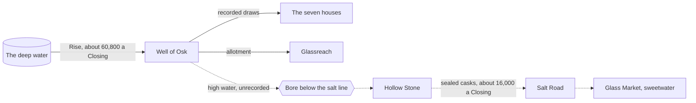

# Knot Reckoning

*Written on the road back from Glassreach, Closings 15 to 17 of 413, by lamplight, while the camels slept.*

> [!warning] Spoilers
> These are Ama's own notes from the middle of [[The Story]]. Read up to [[04 Glassreach]] first.

What I have:

1. **The cord** of the roll of 399 to 401, which I read with my fingers the night of the 15th Closing and tied into my sleeve.
2. **The twin** of 396 to 398 from [[The Glass Annex]], with Sefa Imre's witness knot. Its ink agrees with its cord. The Loom House copy's ink does not.
3. **Dela's cords**: every sealed Varn cask through the yards for six years, weighed and knotted.
4. **Pell's reckoned Rise**, read out at every sitting.

What I think happened, drawn out so I can look at it:



If water leaves the well **without** a recorded draw, then the Rise *reckoned* from the level and the draws comes out low by exactly that much, and the well looks sick. ==Nobody has to lie at any sitting. They only have to stop anyone going down to look at the high water, and make the old rolls agree.==

## The script

Pell lent me a counting-board, but I don't trust my sums when I'm this tired, so I wrote it out the way the Annex keepers check long rolls. Each cord is transcribed as clusters: `o` for a knot, `_` for a gap a thumb wide, `|` between places.

```python
"""Knot reckoning. Ama Seyru's working copy, written on the road back from Glassreach.

Every row of a Linen-Keeper ledger is written twice: in ink, and in knots on
the selvedge cord. Ink can be scraped and rewritten; a knot can only be cut.
Part 1 reads my transcription of the cord and checks it against the ink.
Part 2 checks the Courts' reckoned Rise against Dela Fenn's cask tallies.
"""

from statistics import mean


def read_cord(cord: str) -> int:
    """One cluster per place, highest place first, separated by '|'.

    'o' is a knot; '_' is a gap a thumb wide, an empty place.
    'oooooo|_|oooooooo|_|_' reads six, gap, eight, gap, gap: 60,800.
    """
    value = 0
    for place in cord.split("|"):
        value = value * 10 + place.count("o")
    return value


# Part 1. The Rise rows at the frayed end of the roll of 399 to 401, Loom House copy.
#          (closing, ink as written, cord as read with my fingers)
ROLL_399_401 = [
    ("400/19", 41_650, "oooooo|_|ooooo|_|_"),
    ("400/20", 41_500, "oooooo|o|ooooo|_|_"),
    ("400/21", 41_400, "ooooo|ooooooooo|ooooooooo|_|_"),
    ("400/22", 41_350, "oooooo|_|ooooooooo|_|_"),
    ("400/23", 41_300, "oooooo|o|oooo|_|_"),
    ("400/24", 41_200, "oooooo|_|oooooooo|_|_"),
    ("400/25", 40_950, "oooooo|o|o|_|_"),
    ("400/26", 41_050, "oooooo|_|ooooooo|_|_"),
    ("401/1", 38_400, "ooo|oooooooo|oooo|_|_"),  # the Dry Year: ink and cord agree
    ("401/2", 37_900, "ooo|ooooooo|ooooooooo|_|_"),
]

# Part 2. The Rise as the Courts now reckon it (Pell's low-moon readings plus the
# recorded draws), against the Varn casks Dela weighed out of the yards.
RECKONED_RISE = {"413/10": 44_300, "413/11": 43_900, "413/12": 44_100, "413/13": 44_250,
                 "413/14": 43_800, "413/15": 44_000}
DELA_CASKS = {"413/10": 15_900, "413/11": 16_400, "413/12": 16_000, "413/13": 15_700,
              "413/14": 16_500, "413/15": 16_100}


def main() -> None:
    print("Part 1. Ink against cord, roll of 399 to 401")
    print(f"{'Closing':>8} {'ink':>8} {'cord':>8}  verdict")
    healthy = []
    for closing, ink, cord in ROLL_399_401:
        knots = read_cord(cord)
        if knots == ink:
            verdict = "agree"
        elif knots > ink:
            verdict = "INK LOW: rewritten"  # a slipped knot loses a count, never gains one
        else:
            verdict = "cord low: slipped knot?"
        if not closing.startswith("401"):
            healthy.append(knots)
        print(f"{closing:>8} {ink:>8,} {knots:>8,}  {verdict}")

    true_rise = round(mean(healthy), -2)
    print(f"\nThe well before the Dry Year, by the cord: about {true_rise:,.0f} drams a Closing")

    print("\nPart 2. Missing water against Varn casks")
    print(f"{'Closing':>8} {'reckoned':>9} {'missing':>8} {'casks':>8} {'casks/missing':>14}")
    for closing, reckoned in RECKONED_RISE.items():
        missing = true_rise - reckoned
        casks = DELA_CASKS[closing]
        print(f"{closing:>8} {reckoned:>9,} {missing:>8,.0f} {casks:>8,} {casks / missing:>14.0%}")

    total_missing = sum(true_rise - r for r in RECKONED_RISE.values())
    total_casks = sum(DELA_CASKS.values())
    print(f"\nSix Closings: {total_missing:,.0f} drams missing, {total_casks:,} drams in sealed Varn casks.")
    print(f"Unaccounted for: {total_missing - total_casks:,.0f} drams (spillage, and what House Varn drinks).")


if __name__ == "__main__":
    main()
```

## What it says

```text
Part 1. Ink against cord, roll of 399 to 401
 Closing      ink     cord  verdict
  400/19   41,650   60,500  INK LOW: rewritten
  400/20   41,500   61,500  INK LOW: rewritten
  400/21   41,400   59,900  INK LOW: rewritten
  400/22   41,350   60,900  INK LOW: rewritten
  400/23   41,300   61,400  INK LOW: rewritten
  400/24   41,200   60,800  INK LOW: rewritten
  400/25   40,950   61,100  INK LOW: rewritten
  400/26   41,050   60,700  INK LOW: rewritten
   401/1   38,400   38,400  agree
   401/2   37,900   37,900  agree

The well before the Dry Year, by the cord: about 60,800 drams a Closing

Part 2. Missing water against Varn casks
 Closing  reckoned  missing    casks  casks/missing
  413/10    44,300   16,500   15,900            96%
  413/11    43,900   16,900   16,400            97%
  413/12    44,100   16,700   16,000            96%
  413/13    44,250   16,550   15,700            95%
  413/14    43,800   17,000   16,500            97%
  413/15    44,000   16,800   16,100            96%

Six Closings: 100,450 drams missing, 96,600 drams in sealed Varn casks.
Unaccounted for: 3,850 drams (spillage, and what House Varn drinks).
```

## So

| | Drams per Closing |
|---|---:|
| The Rise, by the cord, before the Dry Year | 60,800 |
| The Rise, as the Courts reckon it now | 44,000 |
| **Missing** | **16,800** |
| Sealed Varn casks through Dela's yards | 16,100 |

Ninety-six parts in a hundred of the missing water is in House Varn's casks. The rest is spillage, and whatever Varn drinks itself. The well is not failing. It is being **drunk**.

> [!note] Still to do
> The cord and the twin prove the ink was rewritten. Dela's cords prove where the water goes. Neither proves the water is still *there*. For that someone has to go down at a Closing and look. See [[Expedition Checklist]].

#ledger #reckoning
