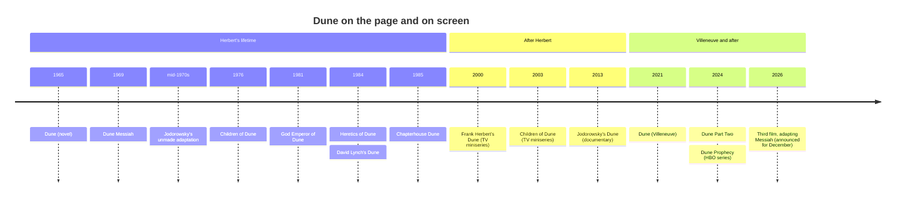

# Kept, Cut and Changed

Every adaptation of *Dune* has to answer the same question: what do you do with a novel that happens mostly inside people's heads? Frank Herbert's book is a political thriller, an ecological treatise and a religious tragedy, but on the page it is above all a chorus of thoughts. Paul calculates, Jessica fears, the Baron schemes, Thufir Hawat weighs probabilities — and Herbert lets us hear all of it, shifting from mind to mind within a single scene. A camera cannot do that. Each filmmaker who has tried has had to choose what to translate, what to drop and what to invent.

## The voices in the head

David Lynch's answer in 1984 was the literal one: whispered voice-over. Characters stand still while their inner thoughts murmur on the soundtrack. It is often mocked, and it can be clumsy, but it is also strangely faithful — it is the only film version that *sounds* like reading the book. It suits Lynch's dream logic, too; the whispers make Arrakis feel like a place where everyone is half asleep.

Denis Villeneuve threw almost all of it away. His films trust faces, silences and visions. Paul's prescience arrives as fragments — Chani in the sand, a burning city, a knife — instead of articulated thought. Jessica's inner conflict lives in Rebecca Ferguson's breathing. The Atreides battle language, a minor detail in the book, becomes a visible sign language that lets mother and son speak privately in a crowded room. The loss is real: we no longer hear Paul *reasoning* his way toward the jihad, and some of Herbert's political machinery becomes invisible. The gain is that the films feel like films.

## Chani, from devotion to doubt

The biggest change Villeneuve made is to Chani. In the novel she is Paul's devoted partner. She bears him a son, accepts that he will marry Princess Irulan for politics, and the book closes on Jessica consoling her that history will remember them, the concubines, as the true wives. Lynch gives Sean Young's Chani little more than a romantic presence.

Villeneuve's Chani is a sceptic. She distrusts the prophecy because she recognises it as something planted in her people by outsiders, and she loves Paul in spite of what he becomes, not because of it. That single change does a great deal of work: it gives the films an internal critic, it moves Herbert's warning from the sequels into the first story, and it sets up the ending of *Part Two* as a break rather than a bittersweet accommodation.[^1]

> [!note] Not a betrayal of the book
> It is tempting to call the new Chani a modern invention. But Herbert himself spent the next novel, *Dune Messiah*, dismantling the heroic reading of Paul. Villeneuve has simply given that later doubt a face earlier in the story. See [[Cuidado con los mesías]] for more.

## Endings: rain, a throne, a walk into the desert

The three versions part ways most sharply at the end.

- **Herbert** ends with Paul victorious and trapped. He has the throne through Irulan and the spice through his power to destroy it, and he knows the jihad he foresaw can no longer be stopped. Victory and doom arrive together.
- **Lynch** ends with a miracle: rain falls on Arrakis, and Paul is proclaimed the Kwisatz Haderach. It is a stirring image and a reversal of the novel's ecology, where water would take generations and Paul's divinity is exactly what Herbert distrusts.
- **Villeneuve** ends with the holy war launched and Chani walking away alone. There is no miracle and no reconciliation, only the beginning of something terrible and one person refusing to kneel.

## Side by side

| | Herbert's novel (1965) | Lynch (1984) | Villeneuve (2021, 2024) |
|---|---|---|---|
| Inner monologue | Constant, shifting between minds | Whispered voice-over | Almost none; faces, visions, sign language |
| The "weirding way" | Bene Gesserit fighting discipline | Sonic "weirding module" weapons | A fighting discipline, plus the Voice |
| Chani | Devoted partner; bears Paul a son | Small, romantic role | Sceptic of the prophecy; the films' conscience |
| Alia | Born; a child who kills the Baron with the gom jabbar | Born; kills the Baron | Unborn throughout; Paul kills the Baron |
| Time among the Fremen | Years | Compressed | Compressed; no son, no time jump |
| Ending | Throne won, jihad inevitable | Rain falls; Paul hailed as messiah | Holy war begins; Chani leaves |
| Overall tone | Political, philosophical, ironic | Baroque, dreamlike, operatic | Austere, monumental, wary |

## What was cut

Both directors cut, and their cuts reveal their priorities. Lynch, compressing the whole novel into one theatrical feature, sacrificed coherence: whole subplots arrive as summaries, and the Fremen years flash by in a montage. Villeneuve, with two films, could afford patience in the first half and still had to compress the second. Thufir Hawat, whose arc in the novel ends in the Harkonnen service and a final act of loyalty, disappears from *Part Two*. Gurney Halleck's suspicion of Jessica as the traitor — a tense thread in the book — is dropped. Most significantly, the years of Paul's life among the Fremen, including the son he loses, are gone. ==Herbert's Paul drifts into his destiny; Villeneuve's Paul turns toward it.==

Lynch's inventions are the bolder ones: the weirding modules, the Baron's grotesque illnesses and "heart plugs", the floating Guild Navigator in the opening scenes. Some are inspired, some are baffling, all are unmistakably his. Villeneuve's inventions are subtler — a female Liet-Kynes, the sign language, the infrared Giedi Prime — and mostly serve to make Herbert's ideas visible rather than to add new ones.[^2]

## Six decades of *Dune*

No adaptation has been, or could be, the book. Lynch made a fever dream that remembers the novel's voice. Villeneuve made a monument that remembers its warning. The book, sixty years on, still holds both. #adaptation

[^1]: The book's closing exchange belongs to Jessica; Villeneuve's version gives the last word, wordlessly, to Chani.
[^2]: Liet-Kynes is a man in the novel and in Lynch's film, played there by Max von Sydow; in Villeneuve's film the role is played by Sharon Duncan-Brewster.
