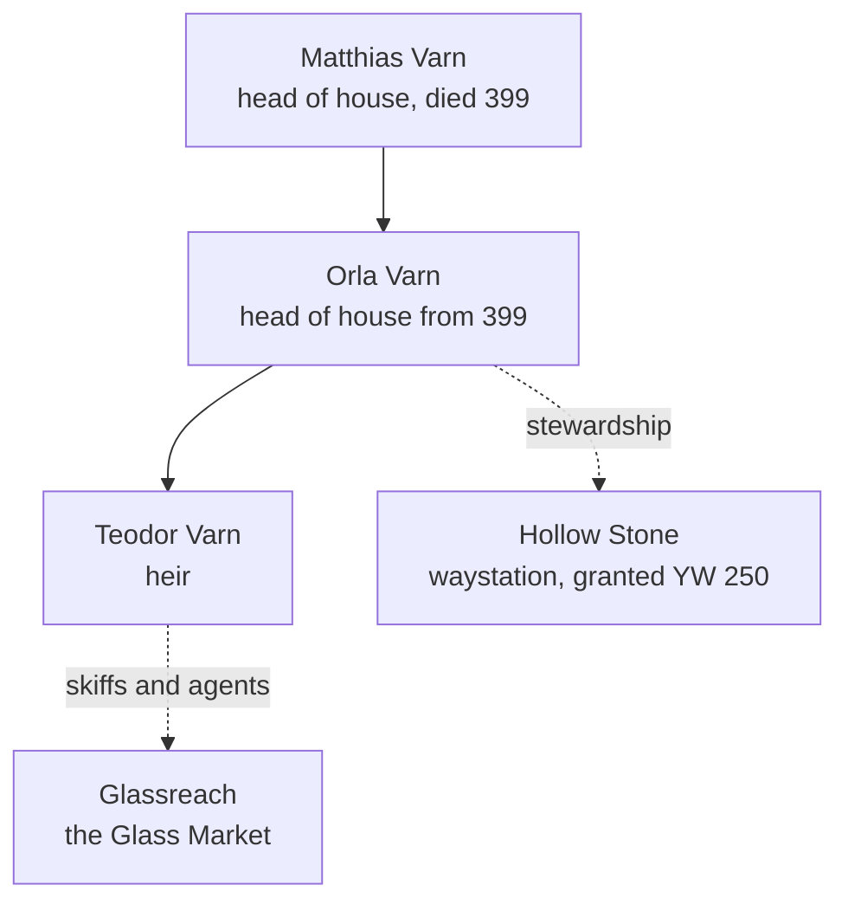

# House Varn

**House Varn** is the oldest and, for the last twelve years, by far the richest of [[The Seven Houses]]. Its colour is a blue so dark it is nearly black; its sigil is a hexagon round a dot, the stone cap of a well. Varn carried the first water up from Osk in YW 1, before there was a Compact, and it has been carrying water ever since: in casks, on camels, and in the wind-skiffs that only Varn knows how to build.

## The family

## Holdings

- **The Varn yards** below the Terraces: the largest cask store at the Courts.
- **[[Hollow Stone]]**, half a day east of the Salt Road: a waystation granted in YW 250.
- **The wind-skiffs**: light sand-sleds with tall sails that make the run to [[Glassreach]] in five days when the wind is right.
- **Agents in Glassreach**, high in the Spires.

## Reputation

Before 413, people said of Varn what people say of every rich house: that it was hard, that it was careful, that it always got its price. Teodor Varn was well liked; Orla Varn was respected the way people respect a sandstorm.

> [!info]- Spoilers: the blue water
> In the Dry Year Orla Varn had an old exploratory bore reopened, running from Hollow Stone to the shaft of the [[Well of Osk]] just below the high-water line. For twelve years it drew off the high water at every Closing, unrecorded, about sixteen thousand drams a fortnight, which went south under blue salt seals and was sold in the Glass Market as *sweetwater*. To hide it, the Rise rows of six years of ledgers were rewritten to show a well that had been failing slowly since 396, and going down the well at a Closing was forbidden.
>
> Since the sitting of 413 the seat of House Varn has stood dark, and will stand dark until its debt to Glassreach is paid in drams. The Keepers read the remaining sum aloud at every sitting. See [[06 What the Glass Remembers]].
