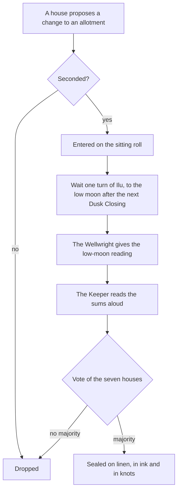

# The Salt Courts

The **Salt Courts** are both a government and a building. The government is the seven merchant houses of the Salt Compact, which together own the [[Well of Osk]] and decide who may draw from it. The building, which everyone calls **the Terraces**, is a long stepped hall of pale stone beside the well: three terraces, seven arches along its face, one for each house, and seven pennants on its roof.

## Sitting at low moon

The Courts sit only at **low moon**, when both [[Ilu]] and [[Thane]] are below the horizon. The Compact of YW 14 says so in its first line, so that no house can ever claim the moons favoured it. In practice this means the morning after each Closing, in the grey hour before the sun, with the lamps still lit.

Each head of house sits on a stool in a shallow horseshoe; heirs and stewards stand behind. A Speaker, chosen by lot from the houses each year, keeps order. The Linen-Keepers sit on a bench above the horseshoe, and the Master Wellwright on a stool to one side.

## How a cut is sealed

> [!note] The oldest rule
> No debt may be sealed on linen until the houses have heard, aloud, the numbers it rests on. *The Keeper's reading is the Keeper's*: the Speaker may not stop it, and the houses may not shorten it. For most of four hundred years the reading took five minutes and nobody listened. In 413 it took most of a morning. See [[06 What the Glass Remembers]].

## The seven arches

From west to east, the arches belong to Varn, Ossary, Tamsk, Quorra, Lirr, Belcane and Hadrel, and each house's pennant flies above its arch. Since the sitting of 413 the blue pennant has been taken down and the Varn arch stands unlit. See [[The Seven Houses]].
