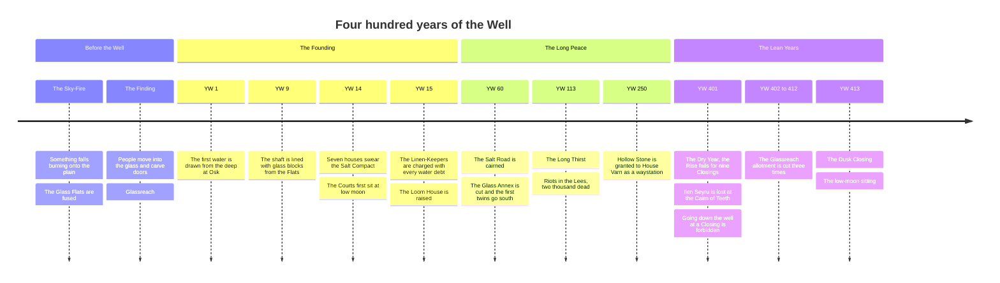

# Timeline

Kessari counts its years from the first water drawn at Osk: **YW**, *years of the Well*. Everything before that is "before the Well", and nobody wrote it down, because there was nobody yet whose job it was.

## The years that matter to the story

| Year | What happened | Read more |
|---|---|---|
| 1 | The Well of Osk is opened | [[Well of Osk]] |
| 14 | The Salt Compact: the seven houses agree to share the well and to sit only at low moon | [[The Seven Houses]], [[The Salt Courts]] |
| 15 | Every water debt is to be written twice, in ink and in knots | [[The Linen-Keepers]] |
| 113 | The Long Thirst: a drought, a panic, a massacre. ==It is the year Teodor Varn quotes== | [[Teodor Varn]] |
| 401 | The Dry Year | [[Ilen Seyru]], [[01 The Linen-Keeper's Daughter]] |
| 413 | Ama Seyru reads the knots aloud | [[06 What the Glass Remembers]] |

> [!info]- Spoilers: what really happened in the Dry Year
> - **YW 401.** As the water fails, [[Orla Varn]] has an old exploratory bore reopened from [[Hollow Stone]] to the shaft of the [[Well of Osk]], just below the high-water line. It draws only at the Closings, when the deep water rises, so the low-moon readings never show it directly.
> - **401, 17th Closing.** [[Ilen Seyru]], carrying the twin of the roll of 399 to 401, is lost at the [[Cairn of Teeth]] the night after a Varn rider comes to the caravan.
> - **401 to 402.** [[Mother Hesk]], under threat, rewrites six years of Rise rows in the Loom House copies, so that the well appears to have been failing slowly since 396. She leaves the knots untouched.
> - **Spring of 401.** Going down the well at a Closing is forbidden "for the safety of the guild", so nobody sees the water still reaching the old salt line.
> - **413, 17th Closing.** The bore is found; at the following sitting the cut is struck and House Varn's seat goes dark. See [[The Story]].
